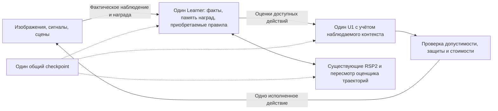

# Один продолжающийся организм с приобретаемыми правилами

**Один ученик продолжил прежнюю жизнь до 11 174 фактических действий и 5499
завершённых эпизодов. Он самостоятельно построил и сохранил программу из
171 условного предиката. На подтверждающей части потребовалось 5321 внешнее
действие против 5905 у прежней системы; общая точность первого ответа не выросла.**

Это приобретение полезной модели внутри общего цикла. Превосходство по точности,
устойчивое рекурсивное самоулучшение и общий интеллект не подтверждены.
Заранее установленный критерий улучшения **не пройден**.

## Что именно живёт и обучается

Изображения, сигналы и навигация не получают отдельных новых учеников.
Меняется наблюдаемый интерфейс; остаются один `ScientificRuntime`, один
`EvoPhase`, один U1 и один Learner. В сохранённых состояниях нет архивированных
заменяющих учеников. Вся приобретаемая программа, память и состояние развития
входят в тот же экспорт. Сравниваемые варианты — контрольные копии полной
продолжающейся жизни, а не отдельные обученные компоненты рабочего организма.

Основной путь состояния:

1. [Прежний живой организм](evidence/organism-lifetime/organism/one-organism.json.gz):
   2200 действий, SHA256 `c05cc2bc70c1525d9990dea81838dc25cc14498d6a68610f63f6cf3020e7fe8d`.
2. [Разработческое продолжение](evidence/acquired-rules/development/organism/one-organism.json.gz):
   5853 действия, SHA256 `e97de732c5952a4b2dafe6fb967258e81e11976d924c7f5f5b98aa130c0f6624`.
3. [Продолжение на следующих данных](evidence/acquired-rules/confirmation/organism/one-organism.json.gz):
   11 174 действия, SHA256 `396f00fa43ca7d46a64e2fd2edc9e2b618c3486abae736d391940ae77be5482b`.

Живой экспорт сохраняет обучение. [Замороженная копия](evidence/acquired-rules/confirmation/organism/frozen-organism.json.gz)
предназначена для неизменяемого вывода; `freeze` не используется для обычного
продолжения жизни. Размер полного несжатого живого checkpoint — **1 556 753 байта**,
из них отчёт памяти наград и правил учитывает 944 954 байта. Это ограниченная
память с уплотнением и потерями, не хранение всех исходных кадров навсегда.

## Полная подтверждающая жизнь

После разработческого продолжения каждый вариант без новой инициализации прошёл:

- 768 новых изображений Fashion-MNIST, обучающие строки 50 000–50 767;
- сохранение, завершение процесса и точное восстановление;
- 768 новых окон UCI HAR, обучающие строки 6000–6767;
- по четыре эпизода Empty-5x5 и DoorKey-5x5;
- 160 других новых изображений, обучающие строки 52 000–52 159.

Сенсорные строки подтверждающей части не использовались для настройки этой
версии. Это последовательная оценка первых ответов с продолжающейся обратной
связью на публичных обучающих данных, а не независимый слепой экзамен.
Навигационные seed 850000–850003 уже встречались в прежней жизни и проверяют
продолжение, не перенос в новые миры. Прежние потреблённые тесты EXTERNAL5 не
пересчитывались.

| Измерение | Общий организм | Тот же контекстный U1 без приобретения правил | Прежний общий U1 без обоих изменений |
|---|---:|---:|---:|
| Изображения, верный первый ответ | 476/768 | 489/768 | 506/768 |
| Сигналы, верный первый ответ | 577/768 | 548/768 | 554/768 |
| Сигналы, balanced accuracy | 74,59% | 71,25% | 71,59% |
| Новые изображения после других сред | 105/160 | 102/160 | 99/160 |
| Всего верных первых ответов | **1158/1696** | 1139/1696 | **1159/1696** |
| Внешних действий на подтверждающей части | **5321** | 5882 | **5905** |
| Empty / DoorKey, успешных эпизодов | 4/4 и 0/4 | 4/4 и 0/4 | 4/4 и 0/4 |
| Учтённая вычислительная работа на этой части | 1 385 816 510 | 1 320 317 976 | 1 308 326 595 |

Относительно прежней системы использовано **на 9,89% меньше внешних действий**,
при почти одинаковом общем числе верных первых ответов. Вычислительная работа
на 5,92% выше: экономия внешних измерений и попыток не означает экономию CPU.
Работа учитывается алгоритмическими счётчиками, а не аппаратными инструкциями.
Предельные бюджеты действий одинаковы: 11 на изображение, 15 на окно сигналов,
64 на навигационный эпизод. «Стоимость» здесь — единицы виртуального бюджета.

На изображениях первый ответ **хуже прежней системы на 3,91 процентного пункта**;
на сигналах и последующих новых изображениях он лучше. Контекстная калибровка
сама по себе не гарантирует полезного переноса. Условные программы также могут
помогать повторным попыткам без улучшения первого ответа. Полное сравнение
нужно именно для обнаружения таких различий.

[Предварительно записанный протокол](evidence/acquired-rules/protocol.json) требовал
роста общей точности минимум на два пункта, ограничения регрессии каждого
сенсорного этапа двумя пунктами, сохранения навигационного успеха и бюджета.
Против прежнего общего U1 общая точность изменилась на −0,059 пункта, а
регрессия изображений превысила предел. Против контекстного контроля прирост
составил +1,12 пункта. **Оба сравнения не прошли критерий превосходства.**
[Основное сравнение](evidence/acquired-rules/confirmation/comparison-previous.json),
[контроль приобретения правил](evidence/acquired-rules/confirmation/comparison-rules-fixed.json).

## Что приобрёл организм

В ходе собственного опыта предложено 16 условных программ и принято одно
изменение оценщика сенсорных действий: семь деревьев с суммарно 171 приобретённым
предикатом для изображений. Потрачено 40 004 979 единиц работы построения;
действующий вариант сохранился после сигналов, навигации и восстановления.
Остальные предложения не прошли внутренний прогнозный допуск. Этот допуск
проверяет последующие фактически подтверждённые успехи и не заменяет сравнение
поведения всего организма. [Алгоритм, пределы и способы включения](ACQUIRED_RULES.md).

В той же жизни существующий RSP2 рассмотрел восемь изменений поисковой
политики; принято **ноль**. Поиск оценщика траекторий выполнялся девять раз,
квалифицированных поведенческих изменений нет. Утверждать, что новая программа
доказывает улучшение самого алгоритма обучения, нельзя. Набор предикатов,
индукция, поисковые операции и сенсорный кодировщик остаются авторскими.

## Проверка организма целиком

[Аудитор фактических данных](../scripts/audit_organism_lifetime.py) восстановил
все **17 108 POST подтверждающей части** трёх вариантов по оригинальным корпусам
и реальным переходам MiniGrid. Проверены первые ответы, доступные моторы,
бюджеты, единственность исполнения, счётчики и восстановление состояния.
[Результат аудита](evidence/acquired-rules/confirmation/audit.json).

Дополнительно [воспроизведён сам полный организм](../scripts/replay_organism_lifetime.py):
3653 разработческих и 5321 подтверждающее действие. Совпали **все 8974 выбора U1
и полные результаты commit**, промежуточные состояния и конечные живой и
замороженный checkpoint — побитово. Это проверка всей связанной программы на
записанном опыте, не новый эксперимент с более высоким результатом.
[Разработческое воспроизведение](evidence/acquired-rules/replay-development/proof.json),
[подтверждающее воспроизведение](evidence/acquired-rules/replay-confirmation/proof.json).

Экспорт также продолжил настоящее обучение на ранее встречавшемся публичном
изображении: **11 174→11 175 действий, 5499→5500 эпизодов**, фактическая награда 1,
изменившийся отпечаток памяти и сохранённые четыре интерфейса.
[Квитанция и продолжающееся состояние](evidence/acquired-rules/continuation/proof.json).
Это проверка продолжения, а не дополнительный экзамен распознавания.

Штатный набор проекта прошёл 490 успешных выполнений Rust-тестов в 52
вызовах; дополнительно проверены 11 Python-проверок внешнего формата.
Это количество выполнений, не число различных независимых экспериментов.
[Сводка и журналы](evidence/acquired-rules/validation.json).

## Воспроизводимость и история

Исполняемый файл подтверждающего прогона заморожен до предъявления следующих
данных; SHA256 `3da35d8d9d7b4c5038e76b0e0a74affc227c482ac8eb9e1f3c03a7df15b1b928`.
Runtime зафиксирован на `4a9e68e`, протокол подтверждения — на `38c6d92`.
Сборка Rust 1.99.0, release opt-level=3, LTO=false, codegen-units=16.
Обе новые стадии используют тот же неизменяемый бинарник. Полные версии
данных и зависимостей, журналы и состояния сохранены в каталогах
[разработки](evidence/acquired-rules/development/provenance.json) и
[подтверждения](evidence/acquired-rules/confirmation/provenance.json).

Первый разработческий вариант без контекстной калибровки также сохранён:
874 против 885 верных первых ответов из 1184, 3611 против 3759 действий.
Второй вариант дал 852 против 831, 3653 против 3938 действий. Эти результаты
разработческие; выбор контекстной архитектуры не превращает второе сравнение
в доказательство превосходства над прежним общим U1. Поэтому в подтверждении
есть оба полных контроля. [Первый отрицательный прогон](evidence/acquired-rules/development-original/comparison.json).

После замороженного прогона устранено отключение последующего мониторинга
при исчерпании бюджета построения программ. Исчерпание теперь останавливает
только построение. Порог допуска не менялся; исходные результаты не
переименовываются в новый экзамен. Изменения относительно замороженного
исходника перечислены в [идентичности источника](evidence/acquired-rules/source-identity.json).
После исправления прошли две регрессии; текущий бинарник воспроизвёл все
5321 действия подтверждающей жизни и вернул те же живой и замороженный
checkpoint побитово. [Проверка текущего кода целиком](evidence/acquired-rules/validation/current-replay-confirmation.json).
Оригинальный поисковый движок RSP2 не изменён.
