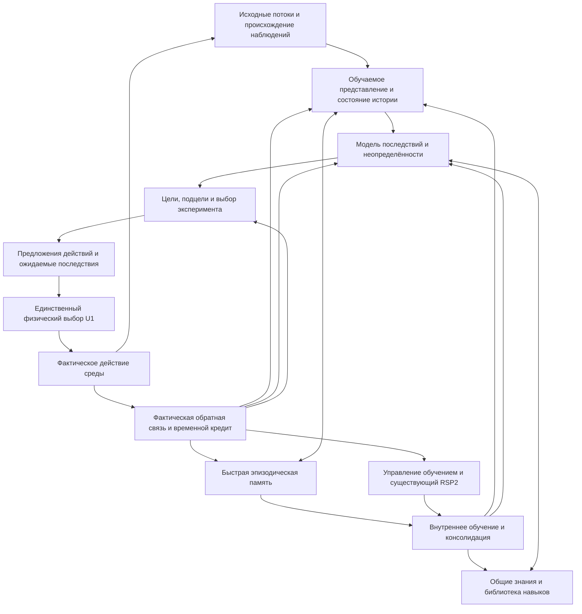

# AETERNA: от исследований мозга к архитектуре обучающегося организма

Дата: 21 октября 2026. Проверенный `main`:
`21df0ba65ecce58f7fde79bdfe1a605c482087c5`.

## Главный вывод и принятое направление

Следующее изменение должно затронуть **обучаемое представление опыта и общий
контур обучения**: восприятие → оценка состояния мира → память → цель →
предсказание последствий → действие → пересмотр знаний. Улучшение очередного
классификатора не создаёт эту связь.

У AETERNA уже есть реальный общий владелец состояния, память фактического
опыта, обучение оценок действий, причинные гипотезы, приобретаемые программы
и рекурсивный поиск. Однако действующий организм получает изображения и
сигналы через фиксированное сжатие; его сохраняемая нейронная часть допускает
преимущественно управление предложениями, а ряд более богатых исследовательских
механизмов несовместим с текущим контрактом совместного checkpoint.
**Общий файл состояния ещё не означает общей обучаемой модели мира.**

Выбрано направление: сохранять единственного владельца `ScientificRuntime`
и единственный физический выбор действия U1, развивать внутри этого владельца
обучаемое восприятие, рекуррентное состояние, модель последствий, две скорости
памяти и управление собственным обучением. Контракт и порядок перехода
зафиксированы в [архитектурном решении](decisions/0001-learning-organism.md).
Это проект изменения архитектуры; описанные новые способности пока не реализованы.

Обзор сопоставляет несколько исследовательских подходов. Он не объявляет
изученными все работы о мозге, не устанавливает единственную теорию мозга
и не представляет проект архитектуры как открытие общего интеллекта.

## Что подтверждено непосредственно в проекте

| Наблюдение по коду | Что из него следует |
|---|---|
| [SensorEncoder](../src/construction/sensors.rs) превращает изображение в 30 средних значений сетки 5×6. У сигнала остаются среднее, стандартное отклонение и средняя абсолютная разность соседних отсчётов каждого канала. | Пространственные детали и направление временной последовательности могут исчезнуть **до любого обучения**. Обучение метрики, правил или поисковой политики этого не отменяет. |
| [new_constructing](../src/unified_runtime.rs) создаёт `Learner`, включает native planning и meta-control. Наблюдение загружается через `observe_initial_real`; полезности предложений поступают в `observe_phase_native_meta_utility`. Дополнительные native-механизмы этим конструктором не включаются. | Есть обучение выбора между предложениями и обучение внутри `Learner`. Из этого нельзя вывести, что в общей жизни обучается вся имеющаяся в репозитории нейронная система восприятия. Второй аргумент `observe_initial_real` — `need`, а не флаг обучения. |
| [constructing_carrier_checkpoint](../src/phase_constructing_control.rs) возвращает `None`, если включены native `drive`, `concepts`, `deep`, `contextual`, `perceptual`, `compositional`, `temporal_evidence`, `online`, `rules`, `partial`, `vector` и другие перечисленные там состояния. Он также требует пустых receptors/circuits и пяти meta-связей. | Дополнительные механизмы намеренно отвергаются, чтобы их состояние не потерялось молча при сохранении. Одновременное включение флагов **не является готовой интеграцией**. Нужен новый контракт обучаемого состояния и его сохранения. |
| В [PhaseNativeState](../src/phase_native.rs) эти механизмы действительно существуют как отдельные опциональные состояния. [ContextualMetaProjection](../src/phase_contextual_meta.rs) при этом уже сохраняется внутри meta-control. | Наработки нельзя объявлять отсутствующими. Native `contextual` и контекстная калибровка U1 — разные механизмы; второй участвует в общем организме. |
| [External reward memory](../src/construction/external_port.rs) требует ширину 32 и 16 моторов; сенсорный namespace и маска занимают две позиции. | Это конкретный текущий интерфейс, а не необходимая граница интеллекта. Увеличить размер массива недостаточно: важнее, что и как в нём обучается. |
| [curriculum развития](../src/organism_development.rs) создаёт задачи RSP2 с пустой `MLibrary`, четырьмя обучающими примерами и целью в виде дисконтированного исхода. Объектному поиску отводятся 32 оценки и семь узлов; на жизнь — восемь попыток. | Механизм рекурсивного изменения поиска есть. Его учебная постановка и доступные представления ограничивают результат. Увеличение числа попыток само по себе не исправит неподходящую цель. |
| [Прежний аудит](ARCHITECTURE_AUDIT_20261021.md) уже обнаружил противоречивые исходы при одинаковых входах развития: минимум 54 неизбежных ошибки детерминированного предсказателя на 512 сохранённых фактах. | Будущее вознаграждение зависит от контекста, последующих действий и случайности. Для него нужна вероятностная оценка и временное состояние; нельзя требовать точной арифметической функции наблюдаемого вектора. Это диагностический результат прежнего состояния, не новый внешний экзамен. |
| [Текстовые задачи](../src/word_problems.rs) и [отношения величин](../src/quantity_relations.rs) имеют обучаемые части, но ограничены заданными арифметическими языками и семействами признаков; это отдельные консольные пути. | В проекте есть работа с текстом. Общая жизнь через `organism_init` пока не демонстрирует обучение понятий из инструкций, диалога и совместного сенсорного опыта. |

Эти ограничения уже частично перечислялись в прежнем аудите. Ошибкой
приоритетов было продолжать преимущественно линию оценщиков и памяти
классификации. Настоящее решение обзора — изменить этот приоритет,
сохранив воспроизводимые прежние результаты.

Последняя ветка оценщиков сохранена отдельно:
[исходный результат исследования](https://github.com/kelbas2007/Aeterna-v1/blob/02cd253b94e316521339db6d1d847560929fa2a7/docs/CAUSAL_READOUT_RESULT.md).
Её общий критерий не пройден из-за потери прежнего навыка. Этот код не
предлагается переносить в `main` как решение проблемы интеллекта.

### Доказательство потери информации без подбора нового benchmark

Для изображения размером 5×12 каждый блок текущей сетки состоит из двух
пикселей. Полосы `[0, 255]` и `[255, 0]` различаются во всех позициях,
но среднее каждого блока одинаково. Все 30 признаков равны 512.

Сигналы `[0, 1, 0, 2]` и `[2, 0, 1, 0]` имеют одинаковые среднее,
стандартное отклонение и среднюю абсолютную разность соседей. Первые три
числовых признака обоих сигналов равны `[768, 849, 1365]`.

Это проверено через JSONL одного runtime: четыре наблюдения, **ноль действий
среды и ноль обучающих действий**. Сохранены
[входы, фактические внутренние векторы и хеши](evidence/brain-architecture-review/sensor-information-witness.json),
[процедура воспроизведения](evidence/brain-architecture-review/reproduce_sensor_witness.py).
Использован ранее замороженный бинарник исследовательской ветки;
`sensors.rs` в ней и проверенном `main` побайтово совпадает.

Формально, если `E(x₁)=E(x₂)`, любая функция только от `E(x)` выдаёт для этой
пары одинаковый результат. Если требуются разные ответы, она не решит оба
случая без дополнительной информации. Это не оценка точности на корпусе и не
запрет сжатия: другой ракурс, измерение, история или обучаемый путь доступа
к исходному наблюдению могут дать недостающее различие. Именно такого пути
в данной статической кодировке недостаточно.

## Что исследования мозга дают для проектирования

Мозг включает специализированные системы с разными временами обучения,
форматами памяти и способами управления. Цельность проявляется в том, что
приобретённые знания меняют общее поведение, а результат поведения меняет
последующее обучение. Не требуется свести всё к одному массиву весов.

Ниже **наблюдение**, **объясняющая модель** и **инженерный вывод** различаются
намеренно: переход от первых двух к устройству AETERNA является проектным
решением, а не установленным нейробиологическим законом.

### 1. Обучаемые представления и активное восприятие

Открытый учебник по вычислительной нейронауке [N1] описывает распределённые
представления, иерархии признаков и обучение на ошибках. Описания Axon [N2]
предлагают конкретную модель предсказательного обучения в коре и таламусе.
Это полезные вычислительные объяснения; модель Axon не является единственным
подтверждённым алгоритмом человеческой коры.

Нужная функция для AETERNA: из потока наблюдений приобретать признаки,
которые помогают предсказывать изменения и решать новые цели. Должен
сохраняться временной порядок; действия должны менять ожидания о следующем
наблюдении. Модальности могут иметь разные входные преобразования, но их
выходы должны связываться общими событиями, объектами и последствиями.

Предсказание не обязательно означает восстановление каждого пикселя.
Инженерные ориентиры V-JEPA 2 [E2] и DreamerV3 [E1] показывают разные
способы учить скрытое представление и последствия. У первого существенны
масштаб предварительного обучения и отдельное обучение на действиях;
второй — полноценная архитектура обучения управлению. Ни один не является
готовым доказательством единого непрерывно обучающегося организма AETERNA.

**Решение:** оставить ограничение ресурсов, обеспечить обучению доступ к
отобранным исходным наблюдениям и обучаемому состоянию. Не делать 30 средних
единственным источником будущего знания.

### 2. Рабочая память: удержание цели, контекста и скрытого состояния

Модели PFC/BG в [N1] объясняют, как удерживать полезную информацию и выбирать
момент её обновления. Это одна из исследовательских линий. В человеческом
исследовании Trübutschek и соавторов [H1] участники могли сообщать положение
субъективно невидимой цели выше случайного уровня после задержки до четырёх
секунд. Авторы сопоставили поведение и MEG и предложили модель кратковременных
синаптических изменений.

В работе участвовали 38 человек в двух экспериментах; в MEG-анализе первого
после исключения шумных записей осталось 13. Часть аргумента основана на
отсутствии обнаруженной активности. Авторы прямо обсуждают ограниченную
чувствительность измерений. Следовательно, работа поддерживает альтернативу
непрерывному активному удержанию, но не доказывает отсутствие всей нейронной
активности и не устанавливает единственный механизм памяти.

Для программы существенна **функция**, а не буквальное копирование MEG-картины:
два одинаковых текущих кадра после разных историй могут требовать разных
действий. Состояние должно удерживать цель, историю значимых измерений,
неопределённость и условия прекращения действия. Namespace интерфейса этого
не заменяет. Рекуррентное обновление должно учиться, а не только увеличивать
счётчик времени или хранить фиксированное число последних векторов.

### 3. Быстрый опыт и медленные обобщения

Теория complementary learning systems, рассмотренная в [N1] со ссылкой на
McClelland, McNaughton и O'Reilly (1995), различает быстрое запоминание
отдельных эпизодов и более медленное приобретение общих закономерностей.
Axon [N2] содержит вычислительную реализацию гиппокампальных механизмов.
Это основание рассматривать несколько скоростей памяти, а не обещание,
что два буфера устранят забывание.

Работа Liu и соавторов [H2] описывает TDLM — метод выявления последовательных
реактиваций по человеческим MEG и данным животных. В рассмотренном
человеческом наборе использованы знакомые объекты и заранее изученная
структурная последовательность. Обнаружение replay не доказывает, что
любой пересмотр старых данных автоматически создаёт абстрактное знание.

Модель Mattar и Daw [N3] делает отдельный шаг: приоритет внутреннего
обновления зависит от ожидаемого изменения поведения (**gain**) и будущей
востребованности состояния (**need**). Это непосредственно видно в
`gainTerm.m`, `needTerm.m` и выборе EVM в `replaySim.m`. Это нормативная
вычислительная модель, а не установленная единственная функция replay мозга.

**Решение:** различать хранение события, извлечение события и внутреннее
обучение на нём. Нынешнее побитовое воспроизведение программы проверяет
правильность исполнения. Консолидация должна **менять представления,
модель или навыки** и улучшать последующее поведение при учтённой стоимости.
Она не обязана сохранять все исходные события навечно.

### 4. Ценность, цели и выбор экспериментов

Модели обучения с подкреплением и данные о сигналах ошибки предсказания
вознаграждения обсуждаются в [N1, N2]. Нельзя отождествлять любой дофамин,
всю мотивацию и всякое знание с одним числом награды.

Keramati и Gutkin [N4] связывают reward с уменьшением отклонения внутренних
физиологических величин от целевого состояния. Это **нормативная теория**
с явными допущениями. Авторы отдельно отмечают, что она не покрывает
социальные и иные награды без соответствующего физиологического механизма.
Искусственные «голод» и «боль» поэтому не выбраны как рецепт интеллекта.

Active inference, представленная библиотекой pymdp [N5], связывает вывод
о скрытом состоянии с практической и информационной ценностью действий.
Однако состояния и матрицы модели в её типовом дискретном интерфейсе задаёт
разработчик. Наличие expected free energy не объясняет автоматически,
как возникнут новые объекты, понятия и модели.

**Решение:** цели и подцели должны использовать общую модель и имеющиеся
потребности задачи. Измерение полезно, когда ожидается изменение решения,
а не просто необычный сигнал. Нужно различать незнание модели и
неустранимую случайность: иначе организм будет бесконечно исследовать шум.
Внешняя задача может быть задана человеком; самостоятельность проявляется
в выборе подцелей, необходимых знаний и различающих действий.

### 5. Временной кредит и обучение самого способа обучения

В [N1, N2] рассматриваются локальная пластичность, ошибки предсказания и
модуляция обучения. E-prop [N6] даёт вычислительный механизм, связывающий
локальные eligibility traces с обучающим сигналом для рекуррентных сетей.
Прочитанная документация авторского кода описывает численное сравнение
с BPTT. Это не доказательство, что человеческий мозг реализует именно e-prop.

У AETERNA уже есть кредит фактическим действиям и подготовительным цепочкам.
Следующая проблема — передавать последствия также тем представлениям,
воспоминаниям, подцелям и решениям об обучении, которые привели к действию.
Повторять вычисление состояния и улучшать процесс обучения — разные вещи.

Для проекта следует различать три утверждения:

| Уровень | Что меняется | Какое доказательство нужно |
|---|---|---|
| Рекуррентное рассуждение | Внутреннее состояние при обработке истории и вариантов | История и внутренние шаги полезны для будущего действия. |
| Обучение | Параметры модели, память, приобретаемые навыки | Новый опыт улучшает ещё не использованное поведение с сохранением прежних навыков. |
| Рекурсивное улучшение обучения | Способ представлять, искать, распределять ресурсы или приобретать следующие навыки | Изменённый механизм лучше обучает следующего производителя на незнакомых семействах при том же общем бюджете. |

Нейронаучные модели не доказывают самопереписывания Rust. Статичный
реализованный разработчиком механизм обучения совместим с приобретением
новых знаний. Новые функции и абстракции могут возникать как композиции
существующего вычислительного языка; для утверждения об изобретении нового
механизма нужно показать изменение возможностей и его перенос.

### 6. Иерархии, навыки, понятия и язык

В [N1] рассмотрены модели иерархического управления и переноса наборов
правил, включая Collins и Frank (2016). Soar [C1] — иной, символический
ориентир: в его исходниках есть явные интерфейсы эпизодического хранения,
поиска и связи с рабочей памятью. Monty [C2] развивает сенсомоторное
обучение, вдохновлённое кортикальными колонками. Их наличие демонстрирует
разные способы организации знаний, а не эквивалентность человеческому мозгу.

Для AETERNA приобретаемое понятие должно быть полезно за пределами
исходного классификатора: выделяться в восприятии, участвовать в ожиданиях,
выбираться в качестве цели и применяться в новой композиции навыков.
Одинаковое имя класса в двух таблицах не обеспечивает такого переноса.

Общую интеллектуальную способность нельзя свести к зрению и управлению.
Нужны также обучение по инструкции и демонстрации, отношения, композиция
целей, общение о неопределённости и перенос знаний между задачами.
Для человека важны развитие, тело и социальное обучение. Этот обзор не
заменяет отдельного исследования языка и социального познания и не
утверждает, что их можно получить увеличением корпуса арифметических задач.

### 7. Цельность и сознание

В конкурирующих теориях сознания остаются существенные разногласия.
Репозиторий Cogitate [C3] фиксирует пререгистрацию и методы сопоставления
теорий. В настоящем обзоре его результаты не объявляются проверенными.
Система может интегрировать знания и улучшать поведение без доказательства
наличия субъективного опыта; слово «сознание» не выбрано критерием готовности.

Для AETERNA цельность должна означать наблюдаемую связь: **то, что организм
узнал в одном взаимодействии, меняет его решения и обучение в другом,
а последствия проходят через ту же память и тот же процесс пересмотра**.
Это совместимо со специализированными частями и разными типами памяти.

## Архитектурное следствие

Все узлы описывают функции внутри одного владельца состояния. Они не
обозначают новые независимые процессы, каждый со своим актором и отдельной
жизнью. Предполагаемые события модели остаются гипотезами; реальный журнал
пополняется только фактическим взаимодействием.

### Что сохранить, изменить и исключить из следующей разработки

| Действие | Конкретное содержание |
|---|---|
| Сохранить | `ScientificRuntime`, U1, происхождение PRE/action/POST, причинные альтернативы и кредит, учёт ресурсов, VM/Library, RSP2, отрицательные результаты и прежние checkpoint. |
| Переработать в общем контуре | Сенсорный путь, обучаемую историю, модель последствий, семантическую консолидацию, единый контракт состояния и его версионирование. Изменение представления должно обновлять память и потребителей согласованно. |
| Использовать после адаптации | Native perception/concept/deep/temporal/drive-наработки. Сначала определить их входы, обучающую цель, владельца состояния и способ сохранения. Не требовать подключения всех модулей ради количества. |
| Исправить постановку самоулучшения | Учебные обязанности из разрешимых предсказаний и полезных навыков, библиотека приобретённых функций, вероятностные цели для шумных исходов, пополняемый бюджет с оплатой поисковых затрат. |
| Остановить как основную линию | Дальнейшую настройку оценщиков Fashion/HAR/MNIST, подбор признаков под отдельный корпус и увеличение числа синтетических семейств ради отчётных побед. Сохранить их как контрольные материалы. |
| Не добавлять без основания | Второго актора рядом с U1, искусственные эмоциональные переменные ради названий, копию всех нейронных флагов, неограниченное хранение сырого опыта, отдельную демонстрацию для каждой заявленной способности. |

**Центральная проверяемая гипотеза:** совместно приобретаемое представление
истории и последствий, связанное с двумя скоростями памяти, даст больше
переносимого знания на единицу опыта, чем текущие фиксированные признаки
и изолированное улучшение оценщиков. Это гипотеза разработки, ещё не результат.
Её необходимо отличить от эффекта большего вычислительного бюджета,
предварительного обучения и нового вручную написанного контроллера.

## Каким должен быть следующий результат

Нужна одна длительная жизнь, в которой зрение, временные сигналы, действия
и инструкции описывают связанные события. Например, организм изучает
управляемую внешнюю систему по её наблюдениям, осваивает способ проверки
гипотезы, затем использует этот способ для новой цели при изменившемся
контексте. Названия объектов, причинные зависимости и необходимый маршрут
не должны приходить из скрытого состояния адаптера.

Один runtime должен сохранять модель, рабочую память, эпизоды, навыки,
состояние обучения и ресурсы между такими переходами. Источник наблюдений
может меняться; правило выбора специального решателя по имени корпуса
не должно обеспечивать результат за организм.

До исполнения нужно зафиксировать:

1. Семейства структурно новых целей и доступные реальные интерфейсы.
   Перестановка меток прежнего генератора не считается новым миром.
2. Происхождение данных, действие, первое предсказание до обратной связи,
   стоимость обучения, памяти, внутренних повторов и внешних обращений.
3. Общее качество решения, число опытов до освоения новой цели, удержание
   старых навыков, калибровку уверенности и ошибки модели на новых траекториях.
4. Сравнение с прежним организмом и простым сильным методом при одинаковом
   доступе к данным, предварительному обучению и ресурсам; несколько независимых
   жизней и интервалы неопределённости по независимым единицам задачи.
5. Для рекурсивного улучшения — отдельную проверку **следующего процесса
   обучения** с сохранённым изменённым механизмом против его родителя.
   Рост точности одного приобретённого навыка этого утверждения не доказывает.

Изъятие компонентов допустимо как диагностика причин эффекта после общей
жизни. Оно не заменяет эту жизнь. Новые внешние данные нельзя многократно
использовать как «независимый экзамен» после изменения механизма.

## Источники и границы прочтения

Это целевой обзор функций, существенных для архитектуры AETERNA. Поиск
и чтение шли через авторские репозитории, открытый учебник и официальный
XML-архив eLife. Прямой доступ к ряду издательств, arXiv и PubMed из среды
был недоступен. Отсутствие выдачи GitHub не трактуется как отсутствие работ.

В [машиночитаемом каталоге](evidence/brain-architecture-review/sources.json)
для каждого файла указаны Git blob, SHA-256, размер и **реальная глубина
прочтения**. Скачанные главы и README не выдаются за прочитанные первичные
статьи. Полные тексты eLife доступны в локальном кэше; прочитанные разделы
перечислены. Копии чужих полных текстов в репозиторий не добавляются.
[Идентичность проверенного кода](evidence/brain-architecture-review/source-identity.json)
фиксирует версию и область аудита.

| Код | Источник | Использование и уровень свидетельства |
|---|---|---|
| H1 | Trübutschek et al. (2017), **A theory of working memory without consciousness or sustained activity**. [10.7554/eLife.23871](https://doi.org/10.7554/eLife.23871), [полный XML](https://github.com/elifesciences/elife-article-xml/blob/master/articles/elife-23871-v2.xml) | Первичное человеческое исследование и модель. Прочитаны abstract, Discussion с ограничениями, Subjects. |
| H2 | Liu et al. (2021), **Temporally delayed linear modelling (TDLM) measures replay in both animals and humans**. [10.7554/eLife.66917](https://doi.org/10.7554/eLife.66917), [полный XML](https://github.com/elifesciences/elife-article-xml/blob/master/articles/elife-66917-v2.xml), [авторский код](https://github.com/YunzheLiu/TDLM) | Метод измерения, данные людей и животных. Прочитаны abstract, Introduction, Discussion и Human replay dataset. Не доказательство универсальной функции replay. |
| N1 | O'Reilly и соавторы, **Computational Cognitive Neuroscience**, [открытая книга](https://github.com/compcogneuro/book), главы 3, 4, 7–9 и библиография | Вторичный обзор и конкретное семейство моделей; прочитаны выбранные разделы. Первичные работы, перечисленные в библиографии, не объявляются прочитанными. |
| N2 | [Emergent/Axon](https://github.com/emer/axon): `Deep.md`, `Hip.md`, `RL.md`, `Rubicon.md`, `PCoreBG.md`, `kinase/README.md` | Механистические вычислительные модели, документация кода. Глубина чтения различается по файлам. Это не общепринятая полная теория мозга. |
| N3 | Mattar & Daw, **Prioritized memory access explains planning and hippocampal replay**, [авторский репозиторий](https://github.com/marcelomattar/PrioritizedReplay) | README и исходники gain/need/выбора повторов; полный текст статьи не получен. |
| N4 | Keramati & Gutkin (2014), **Homeostatic reinforcement learning for integrating reward collection and physiological stability**. [10.7554/eLife.04811](https://doi.org/10.7554/eLife.04811), [полный XML](https://github.com/elifesciences/elife-article-xml/blob/master/articles/elife-04811-v1.xml) | Нормативная теория; прочитаны abstract, Discussion и Limitations and future directions. |
| N5 | Heins et al. (2022), **pymdp: A Python library for active inference in discrete state spaces**. [10.21105/joss.04098](https://doi.org/10.21105/joss.04098), [репозиторий](https://github.com/infer-actively/pymdp) | Прочитаны README и библиографические сведения; статья не заявляется прочитанной. |
| N6 | Bellec et al., **A solution to the learning dilemma for recurrent networks of spiking neurons**, [официальный e-prop](https://github.com/IGITUGraz/eligibility_propagation) | Авторское описание алгоритма и проверок в README; полнотекстовая статья не прочитана. |
| C1 | [Soar](https://github.com/SoarGroup/Soar), `episodic_memory.h` и README | Символическая когнитивная архитектура; проверены выбранные интерфейсы, не весь алгоритм Soar. |
| C2 | [Monty / Thousand Brains Project](https://github.com/thousandbrainsproject/tbp.monty), README | Сенсомоторная модель. Метаданные статьи 2026 [10.1162/NECO.a.1508](https://doi.org/10.1162/NECO.a.1508) взяты из README; результаты статьи независимо не проверены. |
| C3 | [Cogitate consortium](https://github.com/Cogitate-consortium/cogitate-msp1), README | Факт существования пререгистрированного сопоставления теорий; выводы исследования в обзоре не используются. |
| E1 | Hafner et al., **Mastering diverse control tasks through world models**, [DreamerV3](https://github.com/danijar/dreamerv3) | Инженерный ориентир; прочитан README независимой реализации. Общая непрерывная жизнь через все задачи из него не следует. |
| E2 | Assran et al. (2025), **V-JEPA 2: Self-Supervised Video Models Enable Understanding, Prediction and Planning**, [репозиторий](https://github.com/facebookresearch/vjepa2), [arXiv:2506.09985](https://arxiv.org/abs/2506.09985) | Инженерный ориентир; прочитаны описание, область робототехнических задач и цитирование. Заявления о качестве не воспроизводились. |

Для дальнейшего исследования остаются отдельные большие области: развитие
и обучение по социальному опыту, языковая композиция, мозжечковые модели
управления, структурная пластичность, нейромодуляция, причинные вмешательства
и современные альтернативы выбранным моделям памяти. Полнота обзора не
предполагается; решение опирается прежде всего на подтверждённые ограничения
самого AETERNA и на сопоставление нескольких подходов.
