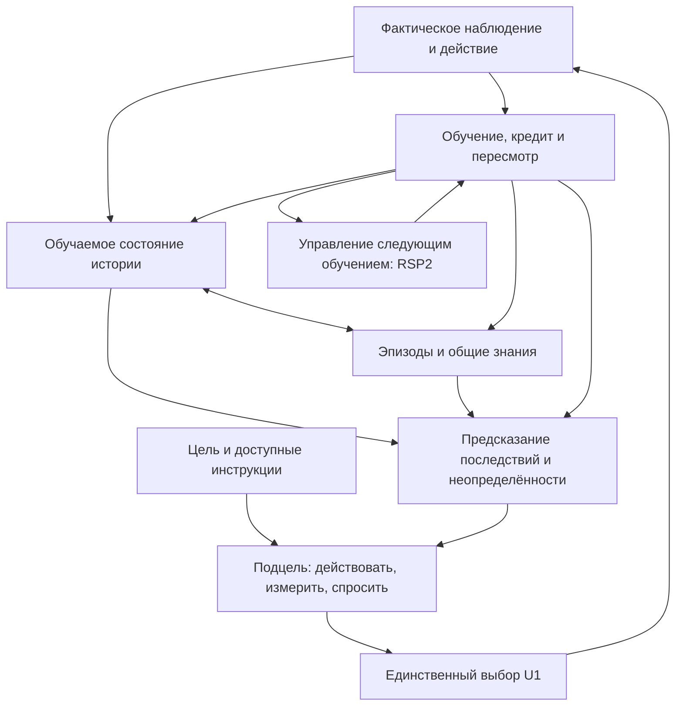

# План развития собственной основы AETERNA

22 октября 2026. Статус: **план; реализация этапов 1–5 ещё не начата**.
Подготовлен после повторного изучения архитектуры и
[обновлённого обзора исследований](DEVELOPMENT_RESEARCH_20261022.md).

## Цель и исходная точка

Нужен продолжающийся организм, который самостоятельно получает недостающие
знания, выбирает различающие действия, приобретает переносимые способы
решения и улучшает освоение следующих задач. Собственная основа обучается
без готовых весов и без внешней модели, принимающей решения за организм.

Первый законченный результат этого плана — наблюдаемая цепь:

> AETERNA встречает новую задачу → определяет, чего не знает → выбирает
> проверку или вопрос → обновляет знания по реальному результату → решает
> задачу → использует найденный способ в следующей задаче → улучшает
> собственный способ обучения без правки исходников между этими шагами.

Это необходимая практическая ступень к требуемому интеллекту. Успешный
ограниченный прототип не будет объявляться общим человеческим интеллектом.
Дата создания общего интеллекта из известных исследований не выводится.

Повторно проверена версия `edb3ff8af37ae02fe1dadf7923aeeaa1c2b7821b`
ветки `research/own-learned-basis`; удалённый `main` — `01a35d0`.
[Идентичность проверенных исходников](evidence/development-plan-20261022/architecture-identity.json).
В PR #23 выросшая основа дала 535/768 против 534/768 без роста.
Это не подтверждает преимущества обучения; RSP2 в сохранённом опыте имел
generation 0 и work 0. Исправление связи знания с U1 сделано разработчиком.

## Какие разрывы устранять

| Уже есть | Чего пока не обеспечивает общий организм | Следующее изменение |
|---|---|---|
| `ScientificRuntime`, общий checkpoint, один U1 | Соседство нескольких обучающихся частей не гарантирует общего знания. | Один контракт наблюдения, состояния, знания, обучения и решения. |
| `learning_world`: исходные потоки, рекуррентная сеть, прогноз действий, два bootstrap-head, replay | Представление ограничено коротким окном; прогнозы и uncertainty сами по себе ещё не дали нужного поведения. | Проверить достаточность истории, калибровку и причинную пользу прогноза в общем действии. |
| `own_basis`: приобретаемые функции и сохраняемые головы навыков | Рост учится по явным меткам; функции не стали общей основой модели мира и VM. | Учить представление на наблюдаемых последствиях и дать одним приобретённым функциям общих потребителей. |
| Причинные альтернативы, память, условные программы, временные options | Перенос на новые реальные структуры не установлен. | Приобретать события, отношения и составные навыки из общего опыта. |
| `OrganismDevelopment` и RSP2 | Текущий curriculum предсказывает исход по узкому входу; это не обучение следующего ученика на новой задаче. Есть конечные лимиты попыток. | Передавать задачи улучшения обучения с вероятностным критерием и отдельным будущим испытанием. |
| Общий конструктор вычислений | В CLI `search_every=1_000_000`; короткая жизнь не включает этот поиск автоматически. | Сделать обязанности, доступность бюджета и причины ожидания видимыми. Простого уменьшения интервала недостаточно. |

Места аудита: `src/learning_world/network.rs::encode/train/forecasts`,
`src/own_basis.rs::teach`, `src/unified_runtime.rs` — подача предложений в U1,
`src/organism_development.rs::curriculum/evolve`,
`src/bin/aeterna-unified.rs` — `organism_init`.
Рекурсивный механизм существует; план меняет его связь с полезным обучением.
В `AdmissionSuite` уже есть `fresh`, `transfer` и `producers`. Эти внутренние
проверки нельзя объявлять отсутствующими; сейчас они проверяют синтез
ограниченных предсказаний из опыта, а не приобретение следующих реальных
навыков всем организмом. Активная политика RSP2 управляет location, priority
и variation поиска. Прямого управления всеми перечисленными ниже процессами
обучения у неё пока нет — для него нужен явный интерфейс.

## Одна архитектура на все этапы

Это функции одного `ScientificRuntime`. Разные входные кодировщики допустимы;
они должны связываться общей историей событий и последствиями. Все обучаемые
состояния, pending-обновления, библиотека и RNG сохраняются вместе.
Модельное предположение никогда не записывается как совершённое действие.

Новое знание имеет происхождение, область применимости, версию представления,
оценку надёжности и ссылки на поддерживающие/опровергающие факты. Его польза
должна прослеживаться до действия. Название класса или namespace не служит
скрытым переключателем готового решателя.

## Этап 1. Общий опыт и реальная среда

**Задача:** получить пригодную для развития жизнь, в которой действительно
можно выбирать, какую информацию получать и что делать с её помощью.

1. Зафиксировать контракт события: исходное наблюдение, время/порядок,
   доступность каналов, прошлое действие, стоимость, последствия и момент
   получения обратной связи. `SensorFrame::Multimodal` уже есть — использовать
   его, не создавать ещё один независимый sensory runtime.
2. Подключить управляемую локальную программную систему: настоящий процесс,
   запросы, задержки, состояние ресурсов и обратимые изменения конфигурации.
   Начальные обязанности — найти причину сбоя и восстановить заданное
   поведение при ограниченном числе запросов. Ответ среды зависит от
   выполнения системы, а не от таблицы правильных ответов в адаптере.
3. Подготовить реальный записанный поток изображений и сигналов. Предпочтение
   синхронным модальностям одного события; UTD-MHAD — кандидат. CORe50 подходит
   для смены ракурса/сеанса и удержания объектов, но не содержит нужных IMU.
   Доступ к новым исходным архивам сейчас не подтверждён: внешние серверы
   возвращают 403. До экзамена необходим доступный источник, лицензия,
   контрольные суммы и разделение по людям/сеансам. Старые HAR/MNIST/Fashion
   использовать только для разработки адаптеров и регрессий.
4. Снять исходное поведение существующего организма и простых методов.
   Для сигналов — последний отсчёт/линейная авторегрессия; для измерений —
   фиксированное и случайное расписание; для системы — фиксированная
   диагностическая стратегия. Их доступ к данным и бюджет описать заранее.

В записанном потоке AETERNA может выбрать следующий доступный фрагмент,
канал или запрос объяснения. Это **активное наблюдение записанного опыта**,
а не физическое воздействие на снятого человека. Управляемая программная
система даёт отдельную проверку реальных вмешательств. Лабораторно заданные
неисправности не выдаются за охват всех производственных аварий.

**Результат этапа:** продолжаемый checkpoint, журнал фактических решений,
внешние адаптеры, доступные данные и честная исходная стоимость. Нужна хотя бы
одна исполняемая реальная среда до разработки следующего контроллера.

**Переход дальше:** нет утечки ответа через имя файла, метку, порядок motor
или код адаптера; исходные наблюдения достаточны для требуемого решения;
известно, сколько стоят один шаг и одна жизнь. Недоступный корпус не
подменяется синтетическим с сохранением заявления о реальных данных.

### Первый реализуемый рабочий пакет

Начать с локального HTTP-сервиса, читающего изменяемый файл и использующего
кэш. Наблюдения — настоящий ответ, свежесть ответа, задержки и доступные
измерения процесса. Действия — запросить измерение, повторить запрос,
изменить разрешённый параметр кэша/обновления. Цель — восстановить свежий
ответ в пределах заданной задержки и цены вмешательства.

Затем добавить самостоятельное семейство: обработку файлов через очередь
настоящих процессов. Отличаться должны зависимости и подходящие действия,
не только номера неисправностей. Единый «сбросить всё» не должен быть
заведомо лучшим решением для всех задач; время простоя и восстановление
учитываются по фактическому выполнению.

Перед обучением нужны четыре конкретных артефакта: описание доступных
наблюдений/действий; адаптер без алгоритма диагностики; одна полная жизнь
существующего организма; таблица стоимости и результатов простого контроля.
Пилот предназначен для проверки исполнимости и причин неудачи. Эти первые
конфигурации используются для разработки, отдельные конфигурации и структура
второго семейства резервируются до соответствующего испытания переноса.
Начальная обязанность уже должна иметь достижимое решение при доступных
наблюдениях; нельзя объявлять наблюдаемую неопределённость ошибкой обучения.

## Этап 2. Общее обучаемое представление и модель последствий

**Задача:** знание, приобретённое при восприятии, должно помогать ожидать
последствия и выбирать действие.

1. Оформить общий интерфейс приобретаемых представлений между `own_basis`,
   `learning_world`, памятью и библиотекой вычислений. Начать с адаптации
   существующей рекуррентной сети; отдельного нового актора не создавать.
2. Обучать по настоящим переходам: что изменится после действия, какие
   признаки сохранятся, какое событие закончится и с какой неопределённостью.
   Явные метки учителя остаются дополнительным источником, а не единственной
   причиной появления новых представлений.
3. Проверить, различает ли история состояния с одинаковым текущим кадром и
   разными последствиями. Если короткого окна не хватает, добавить устойчивое
   состояние/извлекаемый эпизод; увеличивать размер сети только после
   диагностики потери информации. Координаты наблюдения и learned-state
   имеют версии, чтобы обновление кодировщика не испортило старую память.
4. Начать с компактных кодировщиков с пространственной/временной локальностью,
   обученных с нуля. Выбор между существующим кодировщиком и более сложным
   решает одинаковая общая жизнь. Нужны защита от вырождения представления
   и контроль, что модель не тратит весь ресурс на непредсказуемый фон.
5. Обеспечить применение новых признаков в прогнозе и памяти. Предъявить
   пример: знание, полученное из одного канала, меняет полезное решение при
   отсутствии другого. Независимые головы классов этого не доказывают.

Первый вариант модели: компактный обучаемый кодировщик наблюдения и
обновляемое состояние `b[t] = f(b[t-1], observation[t], action[t-1], mask)`.
Предсказание следующего наблюдения/события зависит от выбранного действия.
Использовать существующие recurrent/transition-параметры и два head, добавив
явное сохранение достаточной истории там, где её не хватает. Обучающие цели
поступают из последующего настоящего наблюдения; прогноз события проверяется
до него. Стоимость изменения исходного представления и переиндексации
сохранённых эпизодов входит в бюджет. Большой transformer, полная модель
мозга или новая универсальная нейронная библиотека для этого варианта не нужны.

**Результат этапа:** один организм учится на последовательности, прогнозирует
полезные последствия и использует приобретённое знание для новой цели.

**Переход дальше:** на новых эпизодах улучшилось фактическое достижение цели
или сократилась стоимость при том же качестве относительно исходной системы
и простого метода. Снижения reconstruction loss недостаточно. Контроль с
нарушенной историей/связью действия должен объяснить источник эффекта.

## Этап 3. Самостоятельное исследование и работающая память

**Задача:** AETERNA выбирает, чего ей нужно научиться, и сохраняет полезное
обобщение при ограниченном объёме памяти.

1. Различать недостаток знаний и шум по новым предсказаниям до обратной
   связи; существующее расхождение bootstrap-моделей калибровать, а не
   принимать за готовую меру истинного незнания.
2. Для доступного измерения оценивать ожидаемое изменение решения,
   вероятность разрешения конкурирующих гипотез и стоимость. Сам организм
   выбирает между действием, дополнительным наблюдением, повтором и вопросом.
   Вопрос оплачивается временем/бюджетом взаимодействий, не деньгами.
3. Использовать память эпизодов для поиска различающего опыта и создавать
   общие правила из повторяющихся связей. Положительные и опровергающие
   примеры хранить; пересмотр не должен означать полное стирание старого.
4. Консолидировать выбранные эпизоды в общую модель/программы. Приоритет
   повтора определяется будущей полезностью и проверяемым прогрессом;
   равномерный replay остаётся сильным обязательным контролем.
5. Выделить ограниченные бюджеты для сырого опыта, индекса, общих знаний
   и временного состояния. Удалять дубликаты и малоценный сырой опыт,
   сохраняя происхождение правил. Поиск — по релевантному состоянию/цели,
   не последовательное чтение всего архива. Размер и задержку поиска измерять.

**Результат этапа:** на новой задаче организм сам делает нужную проверку,
прекращает бесполезные повторы и переносит результат на изменённые условия.
После обучения новому и вытеснения части эпизодов старые цели ещё решаются.

**Переход дальше:** при сопоставимом конечном качестве требуется практически
меньше внешних действий, чем при случайном/фиксированном сборе. Нет
бесконечного исследования источника шума. Возврат к старым задачам проверен
в той же жизни; новые файлы памяти сами по себе не считаются результатом.

## Этап 4. Переносимые понятия, программы и обучение через взаимодействие

**Задача:** приобретать способ решения, который можно собрать с другими
способами и применить к новой цели.

1. Описывать навык через условия применения, ожидаемый результат, параметры,
   стоимость и условие завершения. Использовать существующие VM/Library,
   условные программы и temporal options. Предоставить им доступ к тем же
   приобретённым признакам/событиям, которые использует модель мира.
2. Из успешных и исправленных траекторий выделять повторяемые фрагменты,
   сохранять их как вызываемые программы и применять как строительные
   элементы следующих программ. Кандидат не выбирается из списка готовых
   правил конкретной задачи. Составленная организмом программа становится
   новой операцией его библиотеки.
3. Учить связь небольшого словаря инструкций, указания и демонстрации с
   событиями и последствиями. Учитель сообщает разрешённое наблюдение или
   исправление; U1 принимает действие. Новые сочетания знакомых указаний
   должны проверяться отдельно от запоминания готовой команды.
4. Проверять перенос при новых объектах, временных задержках, сочетаниях
   условий и последствиях. Смена названий тех же шаблонов недостаточна.
   Код адаптера не знает, какую последовательность навыков надо выполнить.

Низкоуровневая арифметика и исполнитель остаются написанными человеком.
Задача этапа — самостоятельное построение полезных вычислений поверх них,
их изменение и перенос. Это не выдаётся за изобретение новых аппаратных
инструкций или самопроизвольное возникновение понимания свободной речи.

**Результат этапа:** приобретённый способ «сначала проверить условие, затем
выбрать воздействие» помогает решить новую композицию без отдельного
специального решателя и без переписывания Rust разработчиком.

**Переход дальше:** общий организм решает новые сочетания лучше сопоставимого
варианта без повторного использования навыков. Выигрыш не объясняется
дополнительными метками, памятью или временем поиска. Есть новые случаи,
в которых старый навык уместен, неуместен и требует пересмотра.

## Этап 5. Улучшение собственного обучения через существующий RSP2

**Задача:** изменять способ приобретения следующих знаний и проверять это
не по успеху одного уже выученного навыка.

1. Определить доступные для изменения части процесса обучения: выбор опыта
   для повтора, порядок освоения подцелей, запросы данных, предложение и
   проверка абстракций, распределение поискового бюджета. Изначально менять
   одну ограниченную часть с наблюдаемым влиянием; не весь организм сразу.
   Сначала связать существующий поиск программ с приобретаемыми навыками:
   одна и та же задача синтеза должна иметь последствия для будущего
   поведения. Для replay и других процессов потребуется отдельный общий
   интерфейс операций обучения; существование RSP2 его не заменяет.
2. Передавать RSP2 обязанности, для которых есть доступное представление,
   настоящее пространство кандидатов и обучающий сигнал. Критерий включает
   будущую полезность и цену; стохастический исход оценивается вероятностно,
   а не как обязательное точное целое значение для каждого входа.
3. Сохранять порождённую политику/программу, её родителя, использованный опыт,
   цену поиска, причины допуска и отката. Устранить молчаливое ожидание:
   видно, запускается ли поиск и почему он не запускается.
4. Провести цепь `M0 → M1 → M2`: первый изменённый механизм должен помочь
   следующему обучению; затем этот опыт должен участвовать в получении
   следующего изменения. Между звеньями исходники и правила экзамена
   разработчик не меняет. Поколение в отчёте без выигрыша не засчитывается.
5. Сравнивать следующий процесс обучения с сохранённым родителем при
   одинаковых начальных знаниях, доступе к миру и общем бюджете. Расходы
   поиска улучшения включаются в общий счёт; первоначальное вложение можно
   окупать на заранее определённом наборе последующих задач.

**Результат этапа:** сохранённое самоизменение даёт преимущество при освоении
ещё не использованных задач. Ручное исправление U1, большее число параметров
или дообучение известного класса не являются таким результатом.

**Переход к итоговой квалификации:** повторяется полезное улучшение обучения
на новых структурах; нет ухудшения обязательных старых способностей и
неучтённого увеличения ресурсов. Если полезна только одна смена M0→M1,
фиксируется ограниченное метаобучение; продолжаемая рекурсивная цепь ещё
не подтверждена.

## Как проверять целый организм на каждом этапе

Каждый этап продолжается через один экземпляр, переключение реальных
источников, новые цели, сохранение/возобновление и возврат к старым целям.
Отдельный тест модуля проверяет корректность программы; этап закрывается
только по поведению всей жизни. Диагностические ответвления checkpoint
нужны для причинных сравнений, а не вместо действующего организма.

До квалификационного прогона фиксируются исходники, данные, цели, расходы,
порог освоения и критерий выигрыша. Разработка, настройка и экзамен
разделяются по независимым задачам, людям/сеансам или конфигурациям системы.
Соседние кадры не являются независимыми экзаменами.

| Проверяемое свойство | Наблюдаемый результат |
|---|---|
| Самостоятельность | Полезные измерения/вопросы выбирает организм; без нового знания следующая задача объективно требует больше опыта. |
| Приобретение | Первые решения на ещё не использованных эпизодах улучшаются после опыта. |
| Перенос | Меньше опыта до одинакового уровня качества в новом сочетании/структуре; исходный решатель для него не написан отдельно. |
| Удержание | После нового обучения и ограничения памяти прежние реальные цели решаются в заранее заданном допустимом коридоре. |
| Самоулучшение | Изменённый механизм эффективнее учит последующие навыки с учётом стоимости изменения. |
| Цельность | Полная цепь «опыт → знание → следующее действие → пересмотр» проходит через тот же runtime и сохранённое состояние. |

Предварительная инженерная цель для переноса/метаобучения — **не менее 20%
сокращения внешних взаимодействий** до сопоставимого конечного качества
в двух содержательно разных семействах. Допустимую потерю старого качества
предварительно ограничить **двумя процентными пунктами**. Это выбранные цели
полезности, не числа, выведенные из нейронауки. Порог достаточного качества
и конкретные метрики зависят от реальной обязанности и фиксируются на этапе 1
до чтения экзамена. Эти цели могут потребовать пересмотра по разработческому
пилоту; после открытия экзамена менять их под результат нельзя.

Преимущество должно сохраняться относительно прежнего организма и сильного
простого метода. Число независимых жизней и задач назначается после оценки
разброса и времени на разработческом пилоте. Нужны интервалы неопределённости
для парных различий по задачам/сеансам, а не по коррелированным действиям.
Для удержания требуется проверка допустимой потери, а не просто отсутствие
статистически значимого ухудшения. Малый пилот не объявляется доказательством.
Провал одного обязательного семейства не прячется в среднем результате.
Начальный критерий допуска: наблюдаемое сокращение взаимодействий не менее
20% и нижняя граница заранее выбранного 95%-интервала выше нуля в каждом
обязательном семействе; для удержания нижняя граница разности качества выше
−2 процентных пунктов. Конкретный метод интервала и правило для задач,
не достигших порога освоения, фиксируются до экзамена. Два неудачных ученика
с малым числом действий не могут образовать «выигрыш по скорости».

Учитываются отдельно: внешние действия, помощь учителя, расчётная работа,
фактическое CPU-время, длительность, пик RSS, размер состояния и стоимость
поиска. Прежний счётчик работы не подменяет измерение времени исполнения.

## Ресурсы, порядок работ и условия пересмотра

Текущая среда имеет квоту около четырёх CPU и 32 GiB RAM; GPU-устройство
не предоставлено. План начинается с компактных моделей и коротких опытов,
не с обучения большой универсальной сети на видеокорпусе.

- Первый замер адаптера и полного шага ограничить двумя CPU-часами;
  измерить прогноз длительности до запуска длительного обучения.
- На один разработческий вариант первоначально выделять не более восьми
  CPU-часов. Полный экзамен планировать отдельно по оценённой мощности;
  если достаточный объём не помещается в доступный бюджет, сначала уменьшить
  инженерную стоимость или определить необходимые ресурсы.
- Вначале сохранить текущие ограничения размера памяти/checkpoint. Новые
  лимиты принимать вместе с измерением пользы и стоимости, а не наращивать
  их автоматически. Сжатый файл на диске и память процесса измерять раздельно.
- После двух разработческих вариантов без полезного поведения разбирать
  конкретную причину: нет наблюдаемого различия, не обучается представление,
  плохой прогноз, знание не влияет на выбор или неверна цель метаобучения.
  Следующая правка должна устранять выявленный разрыв. Больше seed или
  новый корпус сами по себе его не исправляют.
- Не переходить к следующему уровню сложности, скрывая провал предыдущего
  добавлением нового модуля. План может пересматриваться по данным;
  исходная цель и история результатов сохраняются.

Надёжная оценка календарного срока возможна после первого полного пилота.
Инженерная интеграция и исследовательский успех имеют разную предсказуемость;
конкретная дата появления развитого интеллекта сейчас не обоснована.

**Ближайший рабочий пакет:** контракт реального события, доступная исполняемая
среда и исходная полная жизнь с измерением стоимости; затем адаптация общего
обучаемого представления. Новый крупный эксперимент классификации перед
этим не назначается.

## Что сохраняем и что прекращаем как главную линию

Сохраняем `ScientificRuntime`, U1, provenance фактов, исходные потоки,
имеющиеся модели/память/VM/RSP2, проверенные checkpoint и отрицательные
результаты. Старые режимы нужны для сравнения и совместимости.

Прекращаем наращивать показатели отдельных Fashion/HAR/MNIST-решателей как
замену основной цели; подключать все имеющиеся флаги без общего контракта;
считать количество правил, сообщений, поколений или тестов мерой интеллекта.
Готовые модели, искусственные эмоции и неограниченное хранение событий
в этот план не включены.

## Состояние исполнения

| Пункт | Состояние |
|---|---|
| Повторный аудит действующего кода | Выполнен для указанной версии. |
| Обновление чтения первичных исследований и оценка ограничений | Выполнено в описанной области, не исчерпывающий обзор всей науки. |
| План, зависимости и правила оценки | Зафиксированы этим документом. |
| Этапы 1–5 | Запланированы; новых способностей этот документ не заявляет. |
