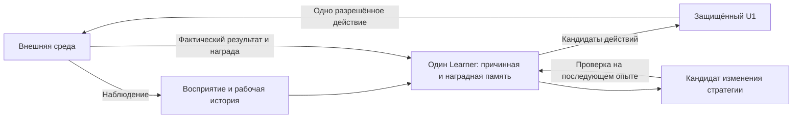

# Один сохраняемый ученик для внешних наблюдений

Новая возможность — общий сенсорный контур канонического `aeterna-v1`. Сцены,
изображения и сигналы входят в один `Learner`, один U1 выбирает действие, а один
checkpoint сохраняет причинные убеждения, награды, восприятие, рабочую историю
и приобретаемую стратегию. Python передаёт реальные наблюдения и исполняет
выбранный мотор; классификатор Python не устанавливается как политика AETERNA.



Общий контур исполнения ещё не доказывает общий интеллект или смысловой перенос
между модальностями. Проверка общей жизни A→B→A измеряет сохранение навыка при
добавлении другого сенсорного контракта. Она не доказывает, что система сама
связала изображение объекта, его название и физическое действие с ним.

## Что приобретает система

Она сохраняет только фактически исполненные PRE/действие/POST и награды.
При отсутствии заданного вектора цели прогнозирует награду и использует
реальные предшественники успешных действий как промежуточные состояния.
При отсутствии полезного наградного прогноза может использовать эксперименты
исходной причинной памяти. Текущая рабочая история помогает прекратить повторение
непродуктивного действия без изменения замороженных долгосрочных знаний.

Восприятие — авторский алгоритм: компоненты и короткие треки объектов для
категориальных сцен, средние по пространственным участкам для изображений,
среднее/разброс/изменчивость для измеренных каналов сигнала. Результаты зависят
от этого ограниченного представления. Неизмеренные каналы отсутствуют во входе;
правильные ответы, скрытые карты и координаты агента не подаются.

«Цена измерения» здесь — условный расход бюджета действий на чтение данных.
Это не денежная оплата. Для записанных данных цена задаётся экспериментом;
фактическое энергопотребление физического датчика не измеряется.

## Ограниченное рекурсивное изменение стратегии

Кандидат строится из последней принятой стратегии. Проверяются число соседей,
степень ядра и веса групп признаков; приоритеты семейств мутаций меняются по
результатам прежних проверок. Кандидат оценивается до подгонки на последующих
реальных наградах. Принятие требует улучшения заранее заданной функции ошибки
и ограниченной проверки сохранности старых фактов. Неудачный кандидат
отклоняется. Решения и фактические интервалы проверки сохраняются в журнале.

Это адаптация обучаемой стратегии в авторском пространстве изменений.
Генератор мутаций и алгоритм обучения остаются программой на Rust. Самостоятельное
изобретение универсальных вычислительных примитивов этим изменением не реализовано.
Выигрыш прогноза отдельного кандидата также не доказывает выигрыш поведения:
для этого предусмотрено сравнение с тем же учеником без изменения стратегии.

## Память и восстановление

Ограничены 2048 сохранённых переходов, 1024 записи статистики наград,
128 рабочих переходов, 512 ожидающих действий и 64 записи проверок стратегий.
Статистика наград учитывает неудачи независимо от отбора успешных примеров;
переполнение хранилища не должно завышать вероятность успеха.
Учёт объёма модели и полный размер checkpoint публикуются отдельно от RSS.
Вытеснение примеров может терять полезные знания; сохранность проверяется
измерением поведения после дальнейшего обучения.

`freeze` прекращает изменение долгосрочных знаний и стратегии. Фактические
наблюдения и рабочие убеждения продолжаются. Неизвестный результат внешнего
действия останавливает исполнение и не превращается в выдуманную неудачу.

## Запуск

Дополнительные операции JSONL: `external_init`, `external_reset`,
`external_step`, `external_episode_end`, `external_reward_report`.
`external_step` выдаёт обычное намерение `action`; доверенный адаптер отвечает
одним `post` с `SensorPost {frame,cost,reward}`. Сохраняется обычный совместный
checkpoint организма. Чтение сенсора не даёт отдельного пути управления мотором.

Повторяемая разработка использует только обучающие разделы:

```sh
source /workspace/.aeterna-env/activate-external5.sh
python scripts/run_external_continual5.py --binary target/release/aeterna-v1 \
  --data /workspace/.aeterna-env/external5-data \
  --output /tmp/external5-new-development --suites sensors --dev-variants full
```

Условия внешней оценки и разграничение разработки/экзамена:
[протокол](EXTERNAL_CONTINUAL5_PROTOCOL.md). Официальные ARC-игры требуют
локального кэша или `ARC_API_KEY` с доступом к `three.arcprize.org`.
Отсутствие доступа отмечается как `BLOCKED`, без выдуманного игрового результата.
